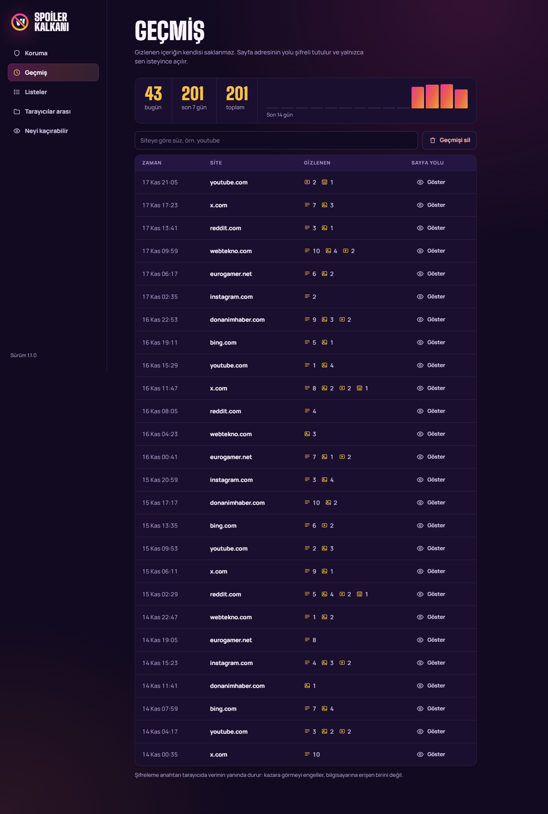

<p align="center"></p>

<h1 align="center">Spoiler Kalkanı</h1>

<p align="center">Oyunu sen oynayana kadar kimse anlatmasın.<br>GTA 6 ile ilgili metin, görsel ve videoları tarayıcıda, sen görmeden önce gizleyen açık kaynak bir Chromium eklentisi.</p>

<p align="center"><a href="../../releases/latest"><b>Hazır sürümü indir</b></a> · <a href="#kurulum">Kurulum</a> · <a href="#geliştirme">Geliştirme</a></p>

> **Bu depoda spoiler yok.** Oyuna özgü isimler `src/dictionary.js` ve `liste.json` içinde ROT13 ile kodludur. Kodu okurken çözmeye çalışma.

<p align="center"> </p>
<p align="center"><sub>Ekran görüntülerindeki geçmiş kayıtları örnek veridir.</sub></p>

## Ne yapar

- **Metin:** Oyunun adını, karakter ve yer adlarını yazım hileleriyle birlikte yakalar: `G.T.A 6`, `GTA VI'nın`, Kiril harfler, Japonca, Çince, Korece, Arapça. Metin ekrana çizilmeden gizlenir.
- **Görsel:** Dosya adına, açıklamasına ve bulunduğu karta bakar. Resmi görsellerin küçültülmüş, kırpılmış ya da yazı eklenmiş kopyalarını parmak iziyle tanır. Görsellerin kendisi depoda yoktur, yalnızca parmak izleri vardır.
- **Video:** YouTube'da video, başlığı ve açıklaması kontrol edilmeden oynamaz. Eşleşen videolar durdurulup sessize alınır.
- **Sayfa:** Konusu doğrudan oyun olan sayfaları tamamen kapatır. Adresinde oyunun adı geçen sayfalar ve oyuna ayrılmış siteler daha yüklenmeden durdurulur.
- **Akışlar:** YouTube, X, Reddit, Instagram, Facebook, TikTok, Twitch ve arama motorlarında yalnızca ilgili kart kalkar, akışın geri kalanı yerinde durur.
- **Katı mod:** Oyunun adını anmayan imaları da yakalar: oyun bağlamında stüdyo adı, şehir adı, numarasız seri adı. Kapatılabilir.
- **Engel geçmişi:** Saat, site ve gizlenen öğe sayısı. Gizlenen içerik saklanmaz; adresin yolu şifreli tutulur. Gizli pencereler kaydedilmez.
- **Tarayıcılar arası ayarlar:** Ayarlar eklenti klasöründeki `ayarlar.json` dosyasında tutulur, aynı klasörü kullanan her tarayıcı onu paylaşır.
- **Otomatik terim listesi:** Çıkıştan sonra ortaya çıkan yeni isimler bu depodaki `liste.json` dosyasından çekilir. Liste yalnızca ekleme yapabilir.

## Kurulum

1. [Releases](../../releases/latest) sayfasından `spoiler-kalkani-*.zip` dosyasını indir ve kalıcı bir klasöre çıkar.
2. Tarayıcının eklentiler sayfasını aç: `brave://extensions`, `chrome://extensions`, `edge://extensions`, `opera://extensions` ya da `vivaldi://extensions`.
3. **Geliştirici modunu** aç ve **Paketlenmemiş öğe yükle** ile çıkardığın `spoiler-kalkani` klasörünü seç.
4. Açılan karşılama sihirbazını izle.

Görsel rehber için depoyu indirip `Kurulum.html` dosyasını aç. Klasörü taşıma ya da silme; tarayıcı eklentiyi her açılışta oradan okur.

## Bilinen sınırlar

Hiçbir eklenti her şeyi yakalayamaz:

- **Metni olmayan yeni görseller:** Başlığı ya da açıklaması olmayan bir ekran görüntüsü, resmi bir görselin kopyası değilse tanınmaz.
- **Videonun içi:** Video kareleri ve ses taranmaz.
- **Tarayıcının kendi yüzeyleri:** Yeni sekme haber akışları (Edge MSN, Brave News) ve adres çubuğu önerileri eklentilere kapalıdır. Sihirbaz bunların nasıl kapatılacağını gösterir.
- **Brave ve klasör senkronu:** Brave, klasöre yazma özelliğini varsayılan olarak kapalı getirir. Ayar dosyasını okuyabilir ama yazamaz.
- **Giriş yapılmış sosyal medya akışları:** X, Instagram, Facebook ve TikTok kart kuralları gerçek, giriş yapılmış bir akışta henüz test edilmedi.

## Geliştirme

Eklenti derleme gerektirmez; düz JavaScript, Manifest V3.

```
spoiler-kalkani/
  manifest.json
  src/
    matcher.js      metin eşleştirme (normalleştirme, kurallar, katı mod)
    content.js      sayfa tarayıcı: kartlar, görseller, video, sayfa kapatma, geçmiş sayacı
    background.js   ağ kuralları, görsel parmak izi, geçmiş, klasör ayarları, uzak liste
    hash.js         64 bit pHash ve 4x4 renk imzası
    dictionary.js   terimler (ROT13)
    main-world.js   gölge DOM ve bildirim köprüsü
  data/hashes.js    resmi görsellerin parmak izleri
  ui/               popup, ayarlar, sihirbaz, engel sayfası, tema, yazı tipleri
liste.json          otomatik güncellenen terim listesi (ROT13)
tools/              testler ve yardımcı betikler
```

Testler için Node.js ve Playwright gerekir:

```
cd tools
npm install playwright@1.49.1
npx playwright install chromium
node test-matcher.js ../spoiler-kalkani
node test-features.js ../spoiler-kalkani
```

### Yeni terim eklemek

`liste.json` içindeki `strong` dizisine terimi ROT13 ile kodlayıp ekle ve `updated` tarihini değiştir. Kodlamak için:

```
node -e "console.log(process.argv[1].replace(/[a-z]/gi,c=>String.fromCharCode((c<='Z'?90:122)>=(c=c.charCodeAt(0)+13)?c:c-26)))" "yeni terim"
```

Eklentiler listeyi günde birkaç kez çeker. Liste yalnızca ekleme yapabilir; yerleşik korumayı kapatamaz, bir siteyi serbest bırakamaz.

### Katkı

Pull request'ler açık. Lütfen başlıklarda, açıklamalarda ve test verilerinde spoiler yazma; oyuna özgü her şeyi ROT13 ile kodla.

## Lisans

Kod [MIT](LICENSE) lisanslıdır. Yazı tipleri (Big Shoulders Display, Manrope) SIL Open Font License altındadır, lisansları `spoiler-kalkani/ui/fonts/` içinde. Bu proje Rockstar Games ya da Take-Two Interactive ile ilişkili değildir; logodaki işaret projenin kendi çizimidir.
