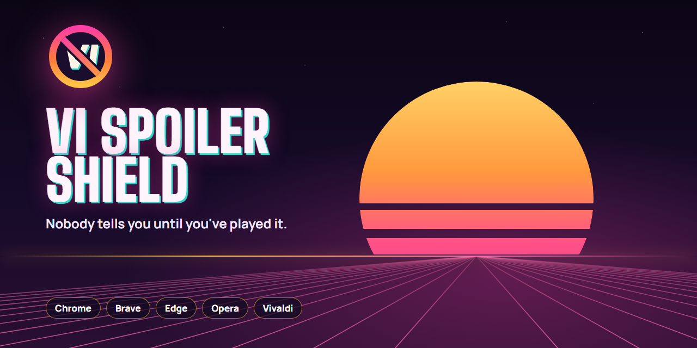
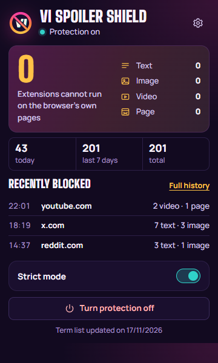
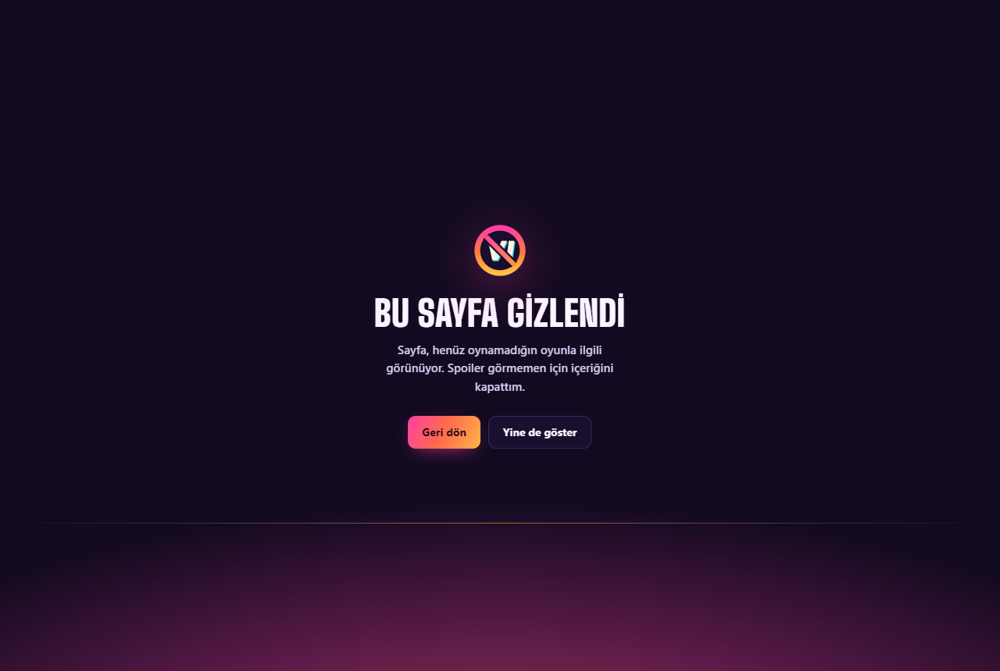
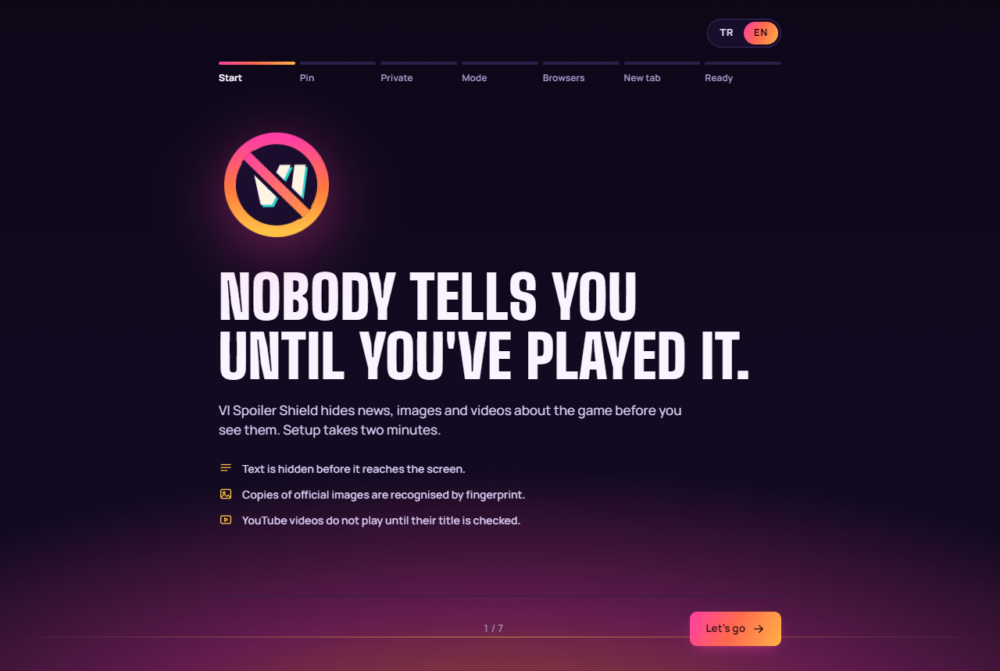
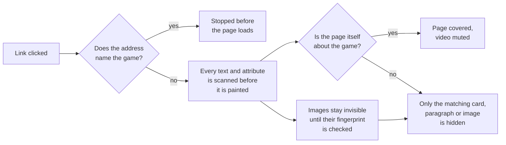

<p align="center"><b>English</b> &nbsp;·&nbsp; <a href="README.tr.md">Türkçe</a></p>

<p align="center">
  
</p>

<p align="center">
  <a href="../../releases/latest"></a>
  
  
  
  <a href="LICENSE"></a>
</p>

<h3 align="center">An open-source browser extension that hides GTA 6 news, images and videos<br>before you see them.</h3>

<p align="center">
  <a href="../../releases/latest"><b>Download the latest release</b></a> &nbsp;·&nbsp;
  <a href="#install">Install</a> &nbsp;·&nbsp;
  <a href="#how-it-works">How it works</a> &nbsp;·&nbsp;
  <a href="#faq">FAQ</a> &nbsp;·&nbsp;
  <a href="#development">Development</a>
</p>

> [!NOTE]
> **This repository is spoiler-free.** Names from the game's world are ROT13-encoded in `src/dictionary.js` and `liste.json`. Please don't decode them while reading the code.

<br>

<table>
  <tr>
    <td width="36%" valign="top"></td>
    <td width="64%" valign="top">
      
      <br><br>
      
    </td>
  </tr>
</table>
<p align="center"><sub>Left to right: the popup, a page that was covered, the setup wizard. History entries are sample data.</sub></p>

## Why

In the days around release, every feed fills up with news, leaks and trailer breakdowns. If you are waiting for the PC version, that means months of dodging spoilers. VI Spoiler Shield does it for you: it finds everything about the game before the page reaches your screen, hides it, and leaves the rest of the page alone.

## Features

<table>
  <tr>
    <td width="50%" valign="top">
      <h4>Text</h4>
      Catches the game's name, character and place names, including tricks such as <code>G.T.A 6</code>, Cyrillic look-alikes, full-width characters, and Japanese, Chinese, Korean and Arabic spellings. Text is hidden before it is painted.
    </td>
    <td width="50%" valign="top">
      <h4>Images</h4>
      Reads file names, captions and the card around each image. Recognises resized, cropped, mirrored and captioned copies of official images by perceptual fingerprint.
    </td>
  </tr>
  <tr>
    <td valign="top">
      <h4>Video</h4>
      On YouTube a video does not play until its title and description are checked. Matching videos are paused and muted, including Shorts and in-app navigation.
    </td>
    <td valign="top">
      <h4>Feeds</h4>
      On YouTube, X, Reddit, Instagram, Facebook, TikTok, Twitch and search engines only the matching card disappears; the rest of the feed stays put.
    </td>
  </tr>
  <tr>
    <td valign="top">
      <h4>Strict mode</h4>
      Also hides hints that never name the game: the studio's name in a gaming context, the city's name, the series name without a number. Content that clearly names an older game, like "GTA 5", stays visible.
    </td>
    <td valign="top">
      <h4>Block history</h4>
      Time, site and how many items were hidden, with a 14-day chart. Hidden content is never stored, page paths are encrypted, private windows are never recorded.
    </td>
  </tr>
  <tr>
    <td valign="top">
      <h4>Same settings in every browser</h4>
      Settings live in an <code>ayarlar.json</code> file inside the extension folder. Every browser running the extension from that folder shares it; lists are merged so no term is lost.
    </td>
    <td valign="top">
      <h4>Automatic term list</h4>
      Names that surface after release are fetched from <code>liste.json</code> in this repository. The list can only add; it cannot turn protection off or allow a site.
    </td>
  </tr>
  <tr>
    <td valign="top">
      <h4>English and Turkish</h4>
      Every screen is available in both languages. It follows the browser's language, or you can pick one in the settings.
    </td>
    <td valign="top">
      <h4>Nothing leaves your computer</h4>
      No account, no analytics, no tracking. See <a href="#privacy">Privacy</a> for the only three network requests it makes.
    </td>
  </tr>
</table>

## How it works



| What is hidden | When |
|---|---|
| **A card, paragraph, comment or image** | When its content mentions the game. On feeds the card disappears without a trace; elsewhere a "Spoiler hidden" placeholder takes its place. |
| **A video** | When its card or title matches. It is paused and muted. |
| **The whole page** | When its address, tab title or main headline clearly names the game, when most of its text is about the game, or when the site is dedicated to it. Strict mode alone never covers a whole page. |

## Install

1. Download `vi-spoiler-shield-*.zip` from [Releases](../../releases/latest) and extract it to a folder you will keep.
2. Open your browser's extensions page and turn on **Developer mode**.
3. Click **Load unpacked** and choose the `vi-spoiler-shield` folder.
4. Follow the setup wizard that opens.

<details>
<summary><b>Extensions page by browser</b></summary>

| Browser | Address | Note |
|---|---|---|
| Chrome | `chrome://extensions` | |
| Brave | `brave://extensions` | Turn off Brave News on the new tab page. |
| Edge | `edge://extensions` | Developer mode is in the left menu. Turn off the news feed on the new tab page. |
| Opera | `opera://extensions` | Turn on "Allow access to search page results". |
| Vivaldi | `vivaldi://extensions` | |

</details>

For a step-by-step visual guide in English or Turkish, open `Install.html` from the zip. Do not move or delete the folder afterwards; the browser loads the extension from it every time.

## Privacy

The extension collects nothing, asks for no account and sends no analytics. The only connections it makes are:

- **Image checks:** an image on the page is downloaded once more from its own source, without cookies, to compute its fingerprint.
- **YouTube titles:** a video's title is read from YouTube's public oEmbed endpoint.
- **Term list:** `liste.json` from this repository is downloaded a few times a day.

The block history and the settings stay on your computer. You can turn the history off or clear it in the settings.

## FAQ

<details>
<summary><b>Something was hidden by mistake. How do I see it?</b></summary>

Double-click the placeholder, or click "Show anyway" twice on a covered page. To turn protection off for a whole site, use the site switch in the popup.
</details>

<details>
<summary><b>A spoiler got through. What should I do?</b></summary>

Right-click it: "Block this image as a spoiler" or "Add the selected text to the block list". From then on the same image and term are hidden everywhere. If it should be added for everyone, open an issue (and please keep the title spoiler-free).
</details>

<details>
<summary><b>I finished the game. How do I turn it off?</b></summary>

Click "Turn protection off" twice in the popup.
</details>

<details>
<summary><b>Why isn't it on the Chrome Web Store?</b></summary>

For now it is installed unpacked in developer mode. That way the code you run is exactly the code you can read here, and you decide when to update.
</details>

## Known limits

No extension catches everything:

- **New images without text:** a screenshot with no title or caption is not recognised unless it copies an official image.
- **Inside videos:** video frames and audio are not scanned.
- **The browser's own surfaces:** new-tab news feeds and address bar suggestions are closed to extensions. The wizard shows how to turn them off.
- **Brave and folder sync:** Brave ships with the File System Access API turned off; it can read the settings file but not write it.
- **Logged-in social feeds:** the X, Instagram, Facebook and TikTok card rules have not been tested on a real, logged-in feed yet.

## Development

The extension needs no build step: plain JavaScript, Manifest V3.

```
vi-spoiler-shield/
├── manifest.json
├── _locales/           extension name and description (en, tr)
├── src/
│   ├── matcher.js      text matching: normalisation, rules, strict mode
│   ├── content.js      page scanner: cards, images, video, page cover, counter
│   ├── background.js   network rules, fingerprints, history, folder settings, remote list
│   ├── hash.js         64-bit pHash plus a 4×4 colour signature
│   ├── i18n.js         interface strings (en, tr)
│   ├── dictionary.js   terms (ROT13)
│   └── main-world.js   shadow DOM and notification bridge
├── data/hashes.js      fingerprints of official images (the images themselves are not included)
└── ui/                 popup, settings, wizard, block page, theme, fonts
liste.json              automatically updated term list (ROT13)
tools/                  tests and helper scripts
```

```
cd tools
npm install
npx playwright install chromium
node test-matcher.js ../vi-spoiler-shield
node test-features.js ../vi-spoiler-shield
```

**Adding a term:** ROT13-encode it, add it to the `strong` array in `liste.json` and update `updated`:

```
node -e "console.log(process.argv[1].replace(/[a-z]/gi,c=>String.fromCharCode((c<='Z'?90:122)>=(c=c.charCodeAt(0)+13)?c:c-26)))" "new term"
```

**Adding a language:** add a block to `src/i18n.js` and a folder under `_locales/`.

**Contributing:** pull requests are welcome. Keep titles, descriptions and test data spoiler-free, and ROT13-encode anything from the game's world.

## License

The code is [MIT](LICENSE) licensed. The fonts (Big Shoulders Display, Manrope) are under the SIL Open Font License; their licenses are in `vi-spoiler-shield/ui/fonts/`.

<sub>This project is not affiliated with Rockstar Games or Take-Two Interactive. The logo and artwork are the project's own; no official imagery is used.</sub>
