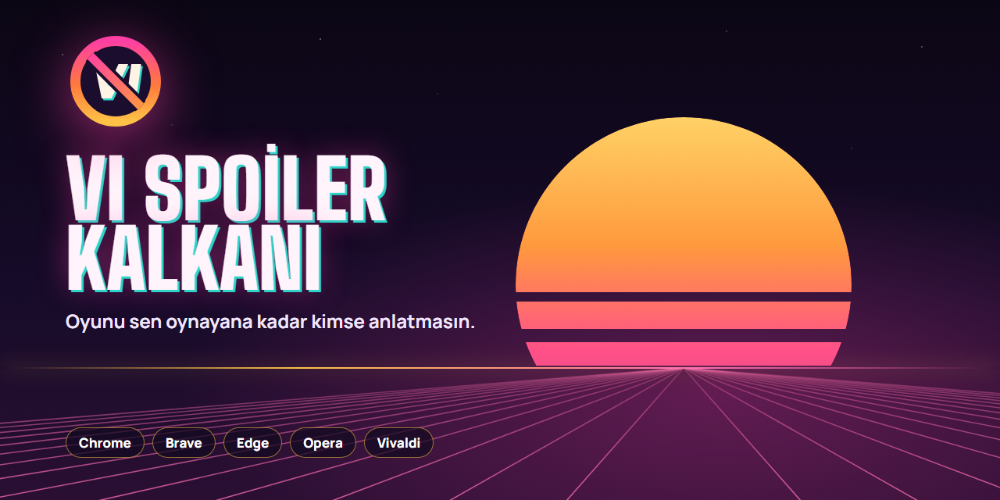
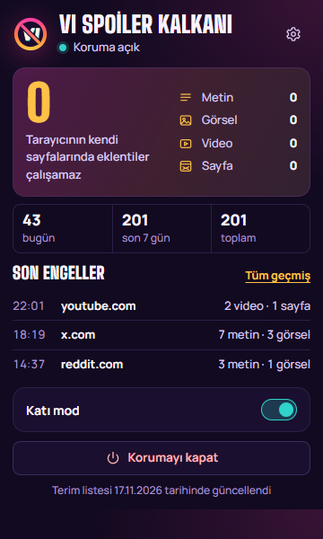
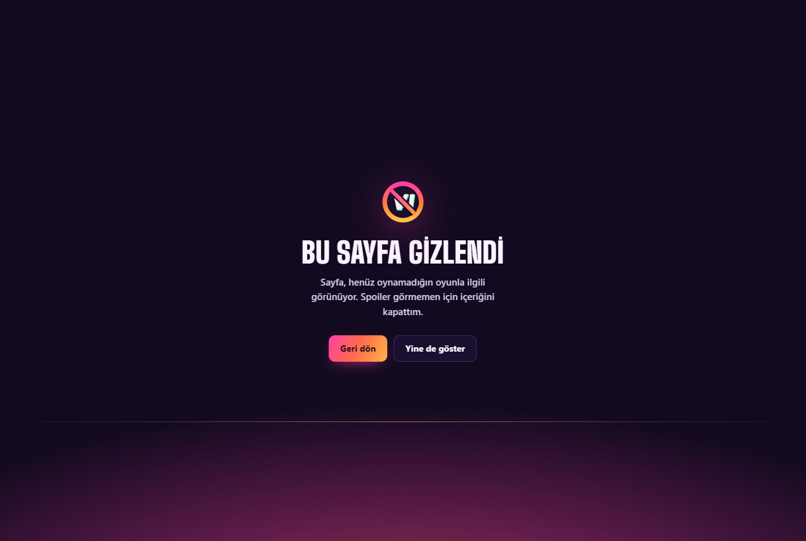
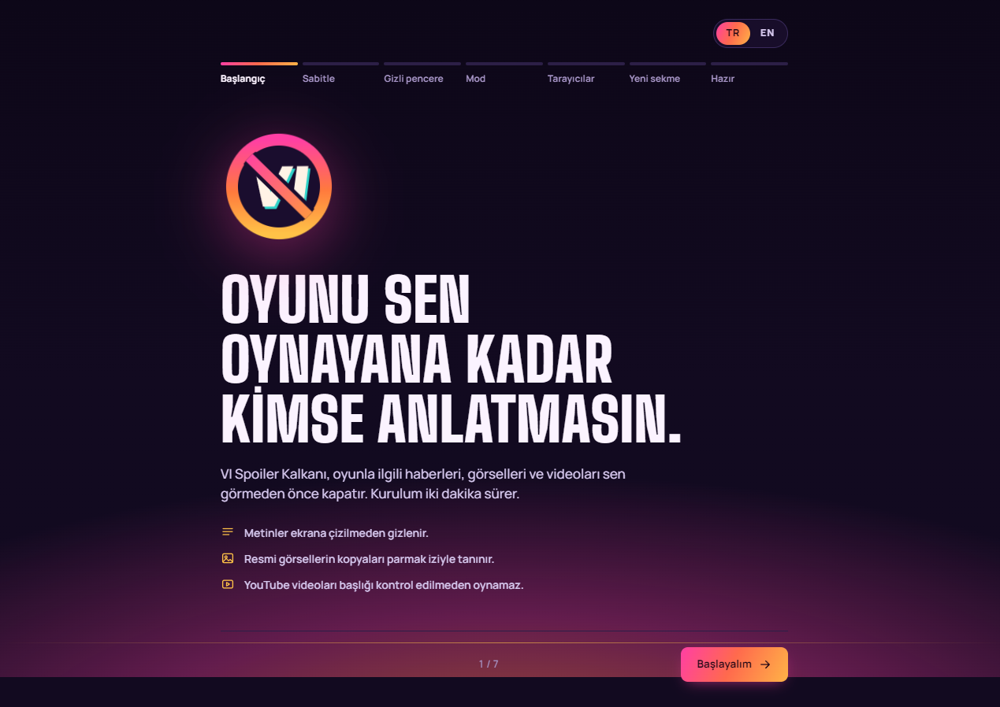
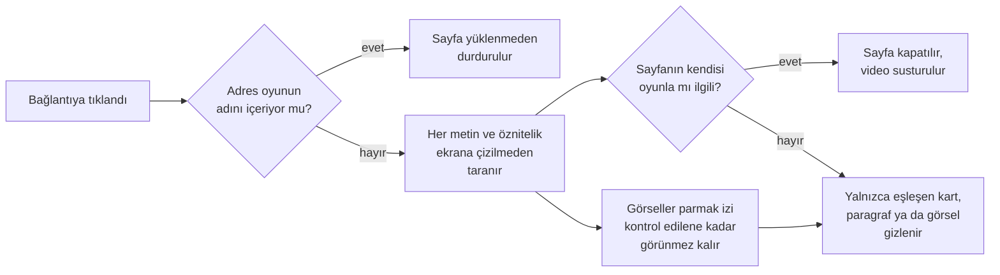

<p align="center"><a href="README.md">English</a> &nbsp;·&nbsp; <b>Türkçe</b></p>

<p align="center">
  
</p>

<p align="center">
  <a href="../../releases/latest"></a>
  
  
  
  <a href="LICENSE"></a>
</p>

<h3 align="center">GTA 6 ile ilgili haberleri, görselleri ve videoları<br>sen görmeden önce gizleyen açık kaynak bir tarayıcı eklentisi.</h3>

<p align="center">
  <a href="../../releases/latest"><b>Son sürümü indir</b></a> &nbsp;·&nbsp;
  <a href="#kurulum">Kurulum</a> &nbsp;·&nbsp;
  <a href="#nasıl-çalışır">Nasıl çalışır</a> &nbsp;·&nbsp;
  <a href="#sık-sorulanlar">Sık sorulanlar</a> &nbsp;·&nbsp;
  <a href="#geliştirme">Geliştirme</a>
</p>

> [!NOTE]
> **Bu repo spoiler içermez.** Oyunun dünyasından isimler `src/dictionary.js` ve `liste.json` içinde ROT13 ile şifrelidir. Kodu okurken lütfen çözmeye çalışma.

<br>

<table>
  <tr>
    <td width="36%" valign="top"></td>
    <td width="64%" valign="top">
      
      <br><br>
      
    </td>
  </tr>
</table>
<p align="center"><sub>Soldan sağa: eklenti penceresi, kapatılan bir sayfa, kurulum sihirbazı. Geçmiş kayıtları örnek veridir.</sub></p>

## Neden

Çıkış günlerinde her akış haberlerle, sızıntılarla ve fragman analizleriyle dolar. PC sürümünü bekliyorsan bu, aylarca spoiler'dan kaçmak demek. VI Spoiler Kalkanı bunu senin yerine yapar: oyunla ilgili her şeyi sayfa ekrana gelmeden bulur, gizler ve sayfanın geri kalanına dokunmaz.

## Özellikler

<table>
  <tr>
    <td width="50%" valign="top">
      <h4>Metin</h4>
      Oyunun adını, karakter ve yer isimlerini yakalar; <code>G.T.A 6</code> gibi hileler, Kiril benzeri harfler, tam genişlikte karakterler ve Japonca, Çince, Korece, Arapça yazımlar dahil. Metin ekrana çizilmeden gizlenir.
    </td>
    <td width="50%" valign="top">
      <h4>Görseller</h4>
      Dosya adlarını, açıklamaları ve görselin çevresindeki kartı okur. Resmî görsellerin boyutu değiştirilmiş, kırpılmış, aynalanmış ve üstüne yazı eklenmiş kopyalarını algısal parmak iziyle tanır.
    </td>
  </tr>
  <tr>
    <td valign="top">
      <h4>Video</h4>
      YouTube'da bir video, başlığı ve açıklaması kontrol edilmeden oynamaz. Eşleşen videolar durdurulur ve sesi kapatılır; Shorts ve site içi geçişler dahil.
    </td>
    <td valign="top">
      <h4>Akışlar</h4>
      YouTube, X, Reddit, Instagram, Facebook, TikTok, Twitch ve arama motorlarında yalnızca eşleşen kart kaybolur; akışın geri kalanı yerinde kalır.
    </td>
  </tr>
  <tr>
    <td valign="top">
      <h4>Katı mod</h4>
      Oyunun adını hiç anmayan imaları da gizler: oyun bağlamında stüdyonun adı, şehrin adı, numarasız seri adı. "GTA 5" gibi açıkça eski bir oyunu anan içerik görünür kalır.
    </td>
    <td valign="top">
      <h4>Engelleme geçmişi</h4>
      Saat, site ve kaç öğenin gizlendiği, 14 günlük grafikle. Gizlenen içerik asla saklanmaz, sayfa yolları şifrelenir, gizli pencereler hiç kaydedilmez.
    </td>
  </tr>
  <tr>
    <td valign="top">
      <h4>Her tarayıcıda aynı ayarlar</h4>
      Ayarlar eklenti klasöründeki <code>ayarlar.json</code> dosyasında durur. Eklentiyi o klasörden çalıştıran her tarayıcı bu dosyayı paylaşır; listeler birleştirilir, hiçbir terim kaybolmaz.
    </td>
    <td valign="top">
      <h4>Otomatik terim listesi</h4>
      Çıkıştan sonra ortaya çıkan isimler bu repodaki <code>liste.json</code> dosyasından alınır. Liste yalnızca ekleyebilir; korumayı kapatamaz, bir siteye izin veremez.
    </td>
  </tr>
  <tr>
    <td valign="top">
      <h4>Türkçe ve İngilizce</h4>
      Her ekran iki dilde de var. Tarayıcının dilini izler; istersen ayarlardan birini seçebilirsin.
    </td>
    <td valign="top">
      <h4>Hiçbir şey bilgisayarından çıkmaz</h4>
      Hesap yok, analiz yok, takip yok. Yaptığı yalnızca üç ağ isteği için <a href="#gizlilik">Gizlilik</a> bölümüne bak.
    </td>
  </tr>
</table>

## Nasıl çalışır



| Ne gizlenir | Ne zaman |
|---|---|
| **Bir kart, paragraf, yorum ya da görsel** | İçeriği oyundan bahsettiğinde. Akışlarda kart iz bırakmadan kaybolur; diğer yerlerde onun yerine "Spoiler gizlendi" kutusu çıkar. |
| **Bir video** | Kartı ya da başlığı eşleştiğinde. Durdurulur ve sesi kapatılır. |
| **Sayfanın tamamı** | Adresi, sekme başlığı ya da ana başlığı oyunun adını açıkça andığında, metninin çoğu oyunla ilgili olduğunda ya da site oyuna ayrılmış olduğunda. Katı mod tek başına hiçbir zaman bütün sayfayı kapatmaz. |

## Kurulum

1. [Sürümler](../../releases/latest) sayfasından `vi-spoiler-shield-*.zip` dosyasını indir ve saklayacağın bir klasöre çıkar.
2. Tarayıcının eklentiler sayfasını aç ve **Geliştirici modu**nu aç.
3. **Paketlenmemiş öğe yükle**ye bas ve `vi-spoiler-shield` klasörünü seç.
4. Açılan kurulum sihirbazını takip et.

<details>
<summary><b>Tarayıcıya göre eklentiler sayfası</b></summary>

| Tarayıcı | Adres | Not |
|---|---|---|
| Chrome | `chrome://extensions` | |
| Brave | `brave://extensions` | Yeni sekme sayfasındaki Brave News'i kapat. |
| Edge | `edge://extensions` | Geliştirici modu soldaki menüdedir. Yeni sekme sayfasındaki haber akışını kapat. |
| Opera | `opera://extensions` | "Arama sayfası sonuçlarına erişime izin ver"i aç. |
| Vivaldi | `vivaldi://extensions` | |

</details>

Adım adım görsel rehber için zip'in içindeki `Install.html` dosyasını aç; rehber Türkçe ve İngilizce. Klasörü sonradan taşıma ya da silme: tarayıcı eklentiyi her seferinde oradan yükler.

## Gizlilik

Eklenti hiçbir şey toplamaz, hesap istemez ve analiz verisi göndermez. Yaptığı bağlantılar yalnızca şunlardır:

- **Görsel kontrolleri:** sayfadaki bir görsel, parmak izini hesaplamak için kendi kaynağından çerezsiz olarak bir kez daha indirilir.
- **YouTube başlıkları:** bir videonun başlığı YouTube'un herkese açık oEmbed adresinden okunur.
- **Terim listesi:** bu repodaki `liste.json` günde birkaç kez indirilir.

Engelleme geçmişi ve ayarlar bilgisayarında kalır. Geçmişi ayarlardan kapatabilir ya da silebilirsin.

## Sık sorulanlar

<details>
<summary><b>Bir şey yanlışlıkla gizlendi. Nasıl görebilirim?</b></summary>

Kutuya çift tıkla ya da kapatılan sayfada "Yine de göster"e iki kez bas. Bir sitenin tamamında korumayı kapatmak için eklenti penceresindeki site anahtarını kullan.
</details>

<details>
<summary><b>Bir spoiler kaçtı. Ne yapmalıyım?</b></summary>

Üzerine sağ tıkla: "Bu görseli spoiler olarak engelle" ya da "Seçili metni engelleme listesine ekle". Bundan sonra aynı görsel ve terim her yerde gizlenir. Herkes için eklenmesi gerekiyorsa bir issue aç (başlığı da lütfen spoiler'sız tut).
</details>

<details>
<summary><b>Oyunu bitirdim. Nasıl kapatırım?</b></summary>

Eklenti penceresinde "Korumayı kapat"a iki kez bas.
</details>

<details>
<summary><b>Neden Chrome Web Mağazası'nda değil?</b></summary>

Şimdilik geliştirici modunda paketlenmemiş olarak kuruluyor. Böylece çalıştırdığın kod tam olarak burada okuyabildiğin koddur ve ne zaman güncelleyeceğine sen karar verirsin.
</details>

## Bilinen sınırlar

Hiçbir eklenti her şeyi yakalayamaz:

- **Yazısız yeni görseller:** başlığı ya da açıklaması olmayan bir ekran görüntüsü, resmî bir görselin kopyası değilse tanınmaz.
- **Videoların içi:** video kareleri ve sesi taranmaz.
- **Tarayıcının kendi yüzeyleri:** yeni sekme haber akışları ve adres çubuğu önerileri eklentilere kapalıdır. Sihirbaz bunları nasıl kapatacağını gösterir.
- **Brave ve klasör eşitleme:** Brave, File System Access API kapalı gelir; ayar dosyasını okuyabilir ama yazamaz.
- **Giriş yapılmış sosyal medya akışları:** X, Instagram, Facebook ve TikTok kart kuralları henüz gerçek, giriş yapılmış bir akışta denenmedi.

## Geliştirme

Eklenti derleme adımı gerektirmez: düz JavaScript, Manifest V3.

```
vi-spoiler-shield/
├── manifest.json
├── _locales/           eklentinin adı ve açıklaması (en, tr)
├── src/
│   ├── matcher.js      metin eşleştirme: normalleştirme, kurallar, katı mod
│   ├── content.js      sayfa tarayıcı: kartlar, görseller, video, sayfa kapatma, sayaç
│   ├── background.js   ağ kuralları, parmak izleri, geçmiş, klasör ayarları, uzak liste
│   ├── hash.js         64 bit pHash ve 4×4 renk imzası
│   ├── i18n.js         arayüz metinleri (en, tr)
│   ├── dictionary.js   terimler (ROT13)
│   └── main-world.js   shadow DOM ve bildirim köprüsü
├── data/hashes.js      resmî görsellerin parmak izleri (görsellerin kendisi dahil değil)
└── ui/                 eklenti penceresi, ayarlar, sihirbaz, engel sayfası, tema, fontlar
liste.json              otomatik güncellenen terim listesi (ROT13)
tools/                  testler ve yardımcı betikler
```

```
cd tools
npm install
npx playwright install chromium
node test-matcher.js ../vi-spoiler-shield
node test-features.js ../vi-spoiler-shield
```

**Terim eklemek:** terimi ROT13 ile şifrele, `liste.json` içindeki `strong` dizisine ekle ve `updated` alanını güncelle:

```
node -e "console.log(process.argv[1].replace(/[a-z]/gi,c=>String.fromCharCode((c<='Z'?90:122)>=(c=c.charCodeAt(0)+13)?c:c-26)))" "yeni terim"
```

**Dil eklemek:** `src/i18n.js` dosyasına bir blok, `_locales/` altına bir klasör ekle.

**Katkı:** pull request'ler memnuniyetle karşılanır. Başlıkları, açıklamaları ve test verilerini spoiler'sız tut; oyunun dünyasından gelen her şeyi ROT13 ile şifrele.

## Lisans

Kod [MIT](LICENSE) lisanslıdır. Fontlar (Big Shoulders Display, Manrope) SIL Open Font License altındadır; lisansları `vi-spoiler-shield/ui/fonts/` klasöründedir.

<sub>Bu proje Rockstar Games ya da Take-Two Interactive ile bağlantılı değildir. Logo ve görseller projenin kendisine aittir; resmî görsel kullanılmamıştır.</sub>
